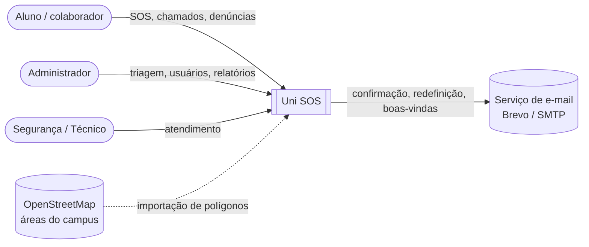
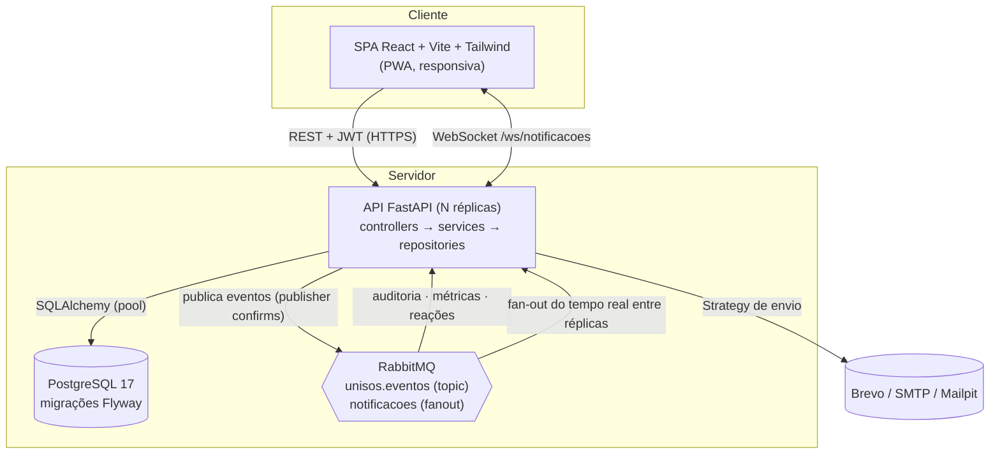
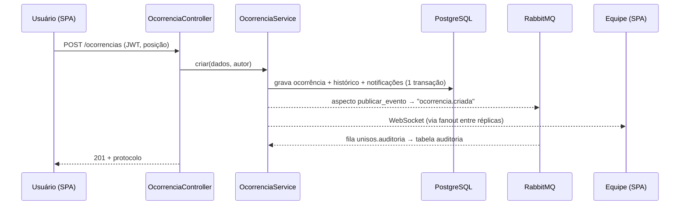

# Arquitetura do Uni SOS

Este documento descreve o estilo arquitetural adotado, por que ele é o modelo mais adequado ao
problema e como as peças se comunicam. Detalhes de POA e eventos estão em
[POA-e-eventos.md](POA-e-eventos.md); os padrões de projeto, em [PADROES.md](PADROES.md); LGPD, em
[LGPD.md](LGPD.md).

## 1. Estilo: monólito modular, em camadas e orientado a eventos

| Característica | Como aparece no código |
|---|---|
| **Monólito modular** | Uma única API FastAPI (`backend/app`) com módulos de domínio bem separados: autenticação, usuários, ocorrências, notificações, relatórios, auditoria, privacidade (LGPD), áreas do campus. |
| **Em camadas** | `controllers/` (HTTP/WebSocket) → `services/` (regras e transação) → `repositories/` (consultas) → `entities/` (tabelas). Entrada e saída sempre por `dtos/` (Pydantic). |
| **Orientado a eventos** | Os services publicam eventos de domínio (`ocorrencia.criada`, `usuario.criado`, `usuario.ativado`...) no RabbitMQ (exchange topic `unisos.eventos`). Consumidores independentes reagem: auditoria, métricas e reações de negócio (boas-vindas). |
| **Interesses transversais por aspectos (POA)** | Auditoria, publicação de eventos, medição de desempenho e log HTTP ficam em `core/aspectos.py` e `core/aspecto_http.py`, não no código de negócio. |
| **API stateless** | Autenticação por JWT; nenhum estado de sessão no servidor. O aviso em tempo real entre instâncias passa pelo RabbitMQ (exchange fanout `notificacoes`). Por isso a API escala horizontalmente. |

### Por que não microsserviços (ainda)

| Critério | Monólito modular | Microsserviços |
|---|---|---|
| Tamanho da equipe | Equipe pequena (acadêmica): um repositório, um deploy | Exige um time por serviço, pipelines e observabilidade distribuída |
| Consistência | Uma ocorrência, seu histórico e suas notificações são gravados na **mesma transação** | Exigiria sagas/compensações para o mesmo fluxo |
| Latência de um SOS | Uma chamada HTTP; nenhuma rede entre serviços no caminho crítico | Várias chamadas de rede até o alerta chegar |
| Custo de operação | 1 API + 1 banco + 1 broker (planos gratuitos: Render, Neon, CloudAMQP) | N serviços, N bancos |
| Escala | Horizontal: N réplicas da API atrás de um balanceador, sincronizadas pelo RabbitMQ | Escala por serviço |

O domínio é coeso (tudo gira em torno da **ocorrência**) e o volume esperado (milhares de
usuários de um campus) cabe com folga em réplicas de um só serviço. A escolha é deliberada, e os
eventos no RabbitMQ deixam o caminho aberto: um consumidor como a fila `unisos.reacoes` pode virar
um serviço separado (ex.: *notification-service*) sem mudar quem produz os eventos.

## 2. Visão de contexto (C4 nível 1)

## 3. Visão de contêineres (C4 nível 2)

## 4. Fluxo principal: um SOS do botão à equipe

## 5. Comunicação por eventos

| Evento | Produtor | Consumidores |
|---|---|---|
| `usuario.criado` | `CadastroService._criar_conta` | auditoria |
| `usuario.ativado` | `VerificacaoEmailService._ativar_conta` | auditoria · **reações** (`boas_vindas_service.dar_boas_vindas`: notificação no sino + e-mail) |
| `ocorrencia.criada` | `OcorrenciaService.criar` | auditoria · métricas |
| `ocorrencia.encaminhada` | `OcorrenciaService.encaminhar` | auditoria · métricas |
| `ocorrencia.status_alterado` | `OcorrenciaService.atualizar_status` | auditoria · métricas |
| `auditoria.*` | aspecto `@auditar` | auditoria |

Garantias: publisher confirms, ack manual, fila de mensagens mortas com reprocessamento periódico
e **fallback** — se o broker cair, a auditoria é gravada direto no banco e os observadores rodam no
próprio processo. A API nunca para por causa do broker.

## 6. Requisitos não funcionais e onde são atendidos

| RNF | Solução |
|---|---|
| Desempenho (< 2 s) | Índices compostos/parciais, paginação por cursor, pool de conexões, aspecto `medir_desempenho` que registra chamadas lentas, teste de carga com Locust (`backend/testes/carga`) |
| Escalabilidade | API stateless (JWT), réplicas sincronizadas pelo RabbitMQ, banco serverless (Neon) |
| Segurança | Argon2 para senhas, JWT assinado, CORS restrito, configuração de produção validada na subida, mascaramento de segredos nos logs, limites de tentativas |
| LGPD | Ciência de termos versionada, exportação dos próprios dados, pedido de exclusão e anonimização, retenção automática ([LGPD.md](LGPD.md)) |
| Disponibilidade | Health check, fallback sem broker, reprocessamento de eventos |
| Usabilidade | SPA responsiva (mobile first), SOS com um gesto, notificações em tempo real |

## 7. Implantação

| Ambiente | Front-end | API | Banco | Broker | E-mail |
|---|---|---|---|---|---|
| Local | Vite / contêiner nginx | Uvicorn / contêiner | PostgreSQL em Docker + Flyway | RabbitMQ em Docker | Mailpit |
| Produção | Vercel | Render | Neon | CloudAMQP | Brevo |
